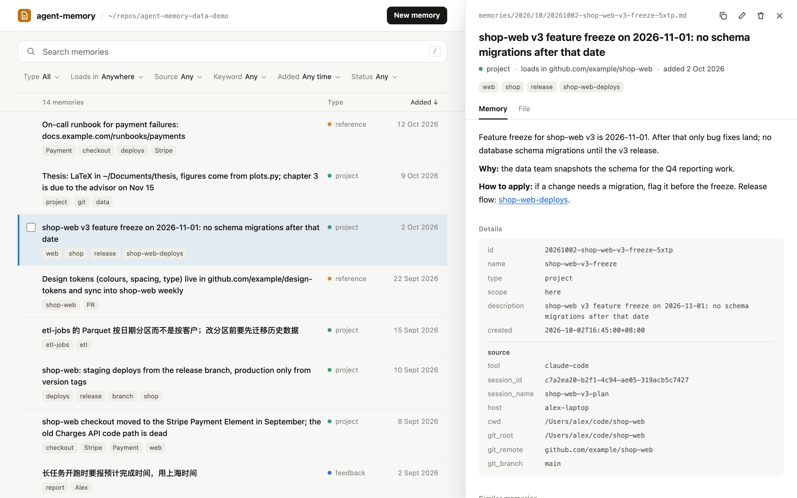

# agent-memory

One memory for Claude Code and Codex, kept as plain Markdown files in a git repository you own.

When a session starts, a hook gives the agent an index of the memories that matter where it is
running: everything marked global, plus what was learned in the same folder or repository. When
a turn ends, a hook commits what the agent wrote, with full provenance (tool, session, host,
folder, git remote), and pushes it. Both tools read and write the same files, so a preference
you gave Codex is there the next time Claude Code starts, on any machine that pulls the data
repository. This repository holds only the code; the memories live in a separate data
repository.



<sub>`mem ui` on the [demo data repository](https://github.com/Ki-Seki/agent-memory-data-demo).</sub>

## Try it without installing

```bash
git clone https://github.com/Ki-Seki/agent-memory
git clone https://github.com/Ki-Seki/agent-memory-data-demo
cd agent-memory
AGENT_MEMORY_DATA=../agent-memory-data-demo bin/mem ui --keywords-only
```

`AGENT_MEMORY_DATA` points `mem` at the demo repository, so nothing is installed and no hooks
change. The page needs `numpy`. `--keywords-only` skips the optional embedding model; leave it
out after `mem ui --fetch-model` to also search by meaning.

## How it works

- **One file per memory.** Frontmatter carries `type` (user / feedback / project / reference),
  `scope` (global / here), a one-line `description`, and provenance under `source`: tool, session
  id and name, model, host, folder, git root, remote, branch and commit. Files live in
  `memories/YYYY/MM/<id>.md`; the folders exist only to keep listings short.
- **Session start.** A SessionStart hook works out where the session runs (folder, host, git
  identity), picks every `global` memory plus the `here` memories recorded at the same place,
  and injects a compact index (under 10,000 characters, the Claude Code hook limit).
- **Writing.** The agent writes new memories into a per-session staging folder and edits existing
  files in place. At the end of each turn a Stop hook stamps ids and provenance, moves staged
  files into `memories/`, commits, and pushes in the background. The agent never writes
  provenance itself.
- **Rules.** [`PROTOCOL.md`](src/agent_memory/PROTOCOL.md) tells the agent what to save and how.
  `mem install` copies it to `~/.config/agent-memory/PROTOCOL.md`, which `~/.claude/CLAUDE.md`
  imports, and into `~/.codex/AGENTS.md` for Codex.

Sessions in throwaway folders (Claude Code scratch workspaces, Codex per-thread folders under
`~/Documents/Codex/<date>/`) get their `here` memories filed under the project folder the
transcript shows them working in most, with the original folder kept as `source.original_cwd`.
`mem relocate` applies the same inference to existing memories. Patterns can be overridden with
`throwaway_patterns` in `~/.config/agent-memory/config.json`.

A `here` memory matches a session when they share the folder (100), the git checkout (90), the
remote (80, other clones and worktrees), or when one folder contains the other (70 / 60). Home
and its direct children such as `~/repos` are too broad to match through containment.

## Setup

Requires Python 3.11+, git and [uv](https://docs.astral.sh/uv/).

```bash
uv tool install "agent-memory-git[ui]"     # the mem command; [ui] adds numpy for mem ui
mem init ~/repos/agent-memory-data     # create the data repository and ~/.config/agent-memory
mem import claude --dry-run            # preview, then run without --dry-run
mem import codex --dry-run
mem install --dry-run                  # shows every change as a diff
mem install
```

To upgrade, run `uv tool upgrade agent-memory-git` and then `mem install`, which refreshes the
protocol copies; `mem doctor` says when they are out of date.

`install` edits, and records in `~/.config/agent-memory/install-state.json`:

| File | Change |
|---|---|
| `~/.claude/settings.json` | SessionStart / Stop / SessionEnd hooks, `autoMemoryEnabled: false`, read/edit permission on the data repository, `mem search/list/show` allowed |
| `~/.claude/CLAUDE.md` | a marked block importing `~/.config/agent-memory/PROTOCOL.md`, a copy of the protocol |
| `~/.codex/hooks.json` | the same three hooks |
| `~/.codex/config.toml` | `memories.generate_memories = false`, `memories.use_memories = false`, data repository added to `sandbox_workspace_write.writable_roots` |
| `~/.codex/AGENTS.md` | a marked block with the protocol |
| `~/.local/bin/mem` | symlink to `mem`, only if that file does not exist yet (`uv tool install` already puts one there) |

Codex asks you to trust new hooks once: open `/hooks` in Codex and enable the three
agent-memory hooks.

`mem uninstall` reverts exactly those edits (other changes the tools made in the meantime are
kept) and turns native memory back on. The data repository is never touched by uninstall.

## Commands

```
mem index [--cwd DIR]           what a session started here would see
mem list [--global|--here|--all] [--type T]
mem search WORDS... [--all]     full-text search; --all includes other locations
mem show ID|NAME|PATH
mem add --name N --type T --scope S --description D BODY|-
mem flush                       commit anything left in staging
mem relocate [PATH...] [--dry-run]  re-file memories recorded in throwaway folders
mem sync [--pull-only]          pull --rebase and push the data repository
mem lint [ID...] [--summary]    list memories that do not follow the body format
mem ui [--port N] [--no-open]   search, filter, read and edit memories in a local page
mem doctor                      check the installation
```

## Managing memories in a page

`mem ui` starts a small server on `127.0.0.1` and opens a page listing every memory. Keep the
terminal open while you use it. It needs `numpy`; the hooks do not.

- **Find.** One search box (press `/`). Word matches appear as you type, with the matching words
  marked; a moment later the local model adds memories close in meaning, across Chinese and
  English. Filters narrow the list by type, where a memory loads (everywhere, or one project or
  folder), which tool wrote it, keyword, age, and whether it needs tidying (what `mem lint`
  reports, also listed on the open memory); the order is newest, oldest, recently changed or A to Z.
- **Read.** Click a row, or move with `j`/`k` and press Enter. The memory opens on the right with
  every frontmatter field (including each `source` entry), the body rendered as Markdown with
  `[[links]]` that open other memories, the file exactly as stored, and the most similar memories.
- **Change.** Edit (`e`) or delete from the open memory, add one with New (`n`), or tick several
  rows (`x`) and delete them together. Every change is one git commit, pushed in the background,
  with Undo. If an agent edits the same file meanwhile, saving is refused rather than overwriting.

Similar memories and search by meaning use Qwen3-Embedding-0.6B, int8 ONNX, on the CPU, in a
separate `uv run --with onnxruntime --with tokenizers` environment; vectors are cached by content
in `<data>/.cache/embeddings/`. Get the model once with `mem ui --fetch-model` (about 625 MB,
pinned revision, checked by SHA-256). Without it, or with `--keywords-only`, similar memories
come from keyword vectors and search matches words only.

Keywords are the words that most set a memory apart from the others (TF-IDF). Words that should
never be keywords, such as your own name, go in `keyword_stopwords` in
`~/.config/agent-memory/config.json`.

The server only listens on loopback, and every request needs the one-time token from the link it
prints, so other web pages cannot read or change memories.

## Development

```bash
uv sync --all-extras          # dev tools and numpy
uv run pytest
uv run ruff check .
```

From a checkout, `bin/mem` (or `uv run mem`) runs the code in place; `mem install` from there
points the hooks at that checkout, so edits take effect in the next session.
`uv tool install --editable .` does the same with `mem` on PATH.

To release, run `uv run scripts/release.py prepare patch` (or `minor`, `major`) to open a
version PR. After it is merged, `uv run scripts/release.py publish <PR_NUMBER>` creates the GitHub
Release, and GitHub Actions publishes it to PyPI.

## Notes

- Hooks never fail the host session; errors go to `<data>/.cache/agent-memory.log`.
- Git operations are serialized with a lock file, so parallel sessions are safe on one machine.
  Across machines, unique file names keep merge conflicts rare; a failed rebase is aborted and
  logged for you to resolve.
- Session names come from Claude Code's `custom-title` transcript entries and Codex's thread
  database, when available.

## License

[MIT](LICENSE)
